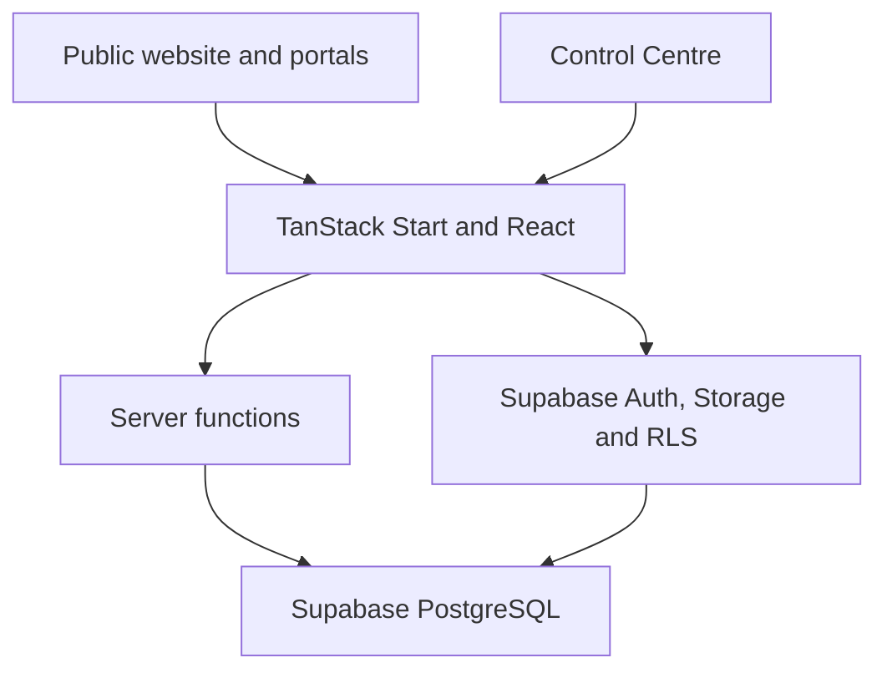

<h1 align="center">
  
</h1>

  <strong>A studio website and operations platform for Branta Tech's creative production, AI and technology services.</strong>

  <a href="https://brantatech.com/"><strong>Live website</strong></a> ·
  <a href="#website-and-portfolio">Website</a> ·
  <a href="#pricing-and-quotations">Pricing</a> ·
  <a href="#client-and-applicant-portals">Portals</a> ·
  <a href="#architecture">Architecture</a> ·
  <a href="#technology">Stack</a>

## Project overview

Branta Tech produces commercial video and imagery and delivers design, software and automation services. Its website gives prospective clients a place to explore that work, understand the scope of a service, estimate a production budget and start a conversation. The same application gives the studio a Control Centre for publishing content, handling sales enquiries and managing recruitment. [About Branta Tech](https://brantatech.com/about) · [Explore services](https://brantatech.com/services)

| Audience | What the platform supports |
| --- | --- |
| Prospective clients | Browse the portfolio, compare services, estimate video or photo pricing, submit a brief, chat with the studio or book a consultation. |
| Clients | Review their own requests and bookings, update their profile and download files shared with their account. |
| Job seekers | Browse open roles, apply through job-specific forms, manage a résumé and see application and interview updates. |
| Branta Tech staff | Publish the website and portfolio, operate the sales and chat queues, maintain pricing and manage applicants through the Control Centre. |

## Website and portfolio

| Experience | Implementation |
| --- | --- |
| [Home](https://brantatech.com/) | A configurable media hero and Capability Explorer introduce the studio. Featured work, testimonials and recognition give visitors supporting context. [Home route](src/routes/index.tsx) |
| [Work](https://brantatech.com/work) | Category filters lead into published case studies with section-based layouts, image and video galleries, credits and related work. The homepage showcase is curated from the same portfolio. [Portfolio routes](src/routes/work.index.tsx) · [Case-study model](src/lib/case-study.ts) |
| [Services](https://brantatech.com/services) and [AI Studio](https://brantatech.com/ai-studio) | Service groups and detail pages describe scope, deliverables and process, with linked portfolio examples and next steps. AI Studio has its own editable page sections. [Services loader](src/lib/services.functions.ts) |
| [Insights](https://brantatech.com/insights) | The editorial area supports articles, authors, excerpts, cover images and share metadata. [Article route](src/routes/insights.$slug.tsx) |
| [About](https://brantatech.com/about) and [Team](https://brantatech.com/team) | Studio information, team profiles and organization structure share content with the website CMS. [Company loader](src/lib/company.functions.ts) |

### Brand, media and discoverability

- **Identity.** The site pairs Branta's orange (`#FF5D00`) with dark and warm neutral surfaces, Geist typography and reusable brand components. The README cover uses the studio's original wordmark and Shahriar Nabil's developer mark. [Design tokens](src/styles.css) · [Brand media](public/media/branta)
- **Video.** A shared player renders posters first, prepares Vimeo or direct video according to priority and viewport proximity, and keeps the poster visible when playback is blocked. Autoplay is muted and the player respects reduced-motion preferences. Vimeo oEmbed supplies poster metadata. [Player](src/components/media/BrantaVideo.tsx) · [Vimeo integration](src/lib/vimeo.server.ts)
- **Search and sharing.** Public pages use route-level titles, descriptions, canonicals and social previews. JSON-LD covers the organization, portfolio work, articles, breadcrumbs and open jobs. The sitemap selects published, indexable content and eligible openings. [SEO helpers](src/lib/seo.ts) · [Sitemap](https://brantatech.com/sitemap.xml)

## Enquiries, booking and chat

1. **Start a project.** A prospective client chooses a service and supplies project details. The server validates the submission, records a lead with a reference and connects the inquiry to the relevant workflow. [Project form](https://brantatech.com/start-a-project) · [Inquiry server functions](src/lib/inquiry.functions.ts)
2. **Book a call.** Public slots are computed from a time zone, weekly availability, exceptions, minimum notice, buffers and active reservations. A PostgreSQL exclusion constraint guards overlapping reservations. Sales staff can confirm, reschedule or cancel bookings. [Booking page](https://brantatech.com/book-a-call) · [Slot calculation](src/lib/booking.functions.ts)
3. **Ask for help.** The chat widget uses a managed knowledge base and phrase matching for English and Bangla enquiries. It can suggest services, work and quick actions, capture visitor details, start booking and hand a conversation to a staff member. Staff have an inbox, presence controls, unanswered-question review and funnel events. [Chat server](src/lib/chat.server.ts) · [Intent matching](src/lib/chat/match.ts)

## Pricing and quotations

| Capability | How it works |
| --- | --- |
| AI video estimator | Uses video type, duration, model, production tier, base fee and selected extras. The engine accounts for per-second and per-scene charges, project minimums, rounding and configured tax. [Video pricing engine](src/lib/pricing/engine.ts) |
| AI product photography estimator | Uses product quantity, view or package selection, image count, eligible volume discounts and extras. [Photography engine](src/lib/pricing/photo-engine.ts) |
| Server-side calculation | The calculators operate in integer currency minor units. Quote submissions validate the configuration and recalculate totals server-side. The request records an estimate snapshot in the relevant video or photography format. [Quote submission](src/lib/quotes.functions.ts) |
| Staff review | Sales can prepare revisions, use templates, record follow-ups and link a quote to a lead or booking. Rate proposals, approval and a simulator support changes to published pricing. [Pricing admin](src/routes/control-centre._admin.pricing.index.tsx) · [Quote builder](src/lib/pricing/quote-builder.ts) |
| Customer delivery | Staff issue an immutable quote version with a tokenized link and validity date. Customers can accept, decline or request changes. The branded PDF renders from the issued snapshot, so subsequent rate edits do not alter it. [Customer quote](src/routes/quote.$token.tsx) · [PDF renderer](src/lib/pricing/quote-pdf.ts) |
| Follow-up and measurement | Quote activity tracks revisions and responses. The schema includes a scheduled expiry reconciler and customer-facing reads also check validity. Pricing analytics summarize requests and outcomes. [Quote lifecycle](src/lib/pricing/phase5.ts) · [Pricing analytics](src/routes/control-centre._admin.pricing.analytics.tsx) |

[Explore the live pricing tools](https://brantatech.com/pricing)

## Client and applicant portals

### Client portal

Clients can sign in with email or Google and access their own profile, requests, consultations and shared files. The dashboard scopes queries to the account and creates short-lived links for private files under Storage policies. [Client dashboard](src/routes/client.tsx) · [Client data access](src/lib/client-data.ts)

### Careers and applicant tracking

- **Public listings.** Open jobs have a role description, application window, job-specific eligibility and an application entry point. [Careers](https://brantatech.com/careers) · [Job model](src/lib/job-details.ts)
- **Applications.** A staged form adapts to configured questions and attachments. An applicant can save a draft, reuse a saved résumé, submit an application and track its status. The server validates documents and keeps applicant files in private Storage. [Application wizard](src/components/careers/ApplyWizard.tsx) · [Application server](src/lib/careers.functions.ts)
- **Applicant account.** Applicants can manage their profile and résumé, review their submissions, withdraw an application and see interview details when scheduled. [Applicant account](src/routes/careers.account.tsx)
- **HR review.** Staff publish roles, screen and filter applications, add internal notes, change stages and schedule interviews. A filtered spreadsheet export is available for recruitment work. [Applications queue](src/routes/control-centre._admin.careers.applications.index.tsx) · [Spreadsheet export](src/lib/application-export.ts)

## Control Centre

| Workspace | Staff tools |
| --- | --- |
| Website CMS | Navigation, page sections, site settings, media, team, services, portfolio categories, project sections, testimonials, recognition, articles and authors. |
| Sales | Lead queue, consultation calendar and availability, video and photo rate configuration, quotation templates, follow-ups and pricing analytics. |
| Support | Realtime inbox, quick actions, knowledge entries, handoff settings and unanswered enquiries. |
| Recruitment | Job openings, application fields, screening, applicant activity, interviews and exports. |
| Access | Supabase sessions with staff roles for administrators, HR and sales. Client and applicant accounts enter their own routes. |

[Control Centre route](src/routes/control-centre._admin.tsx) · [Staff roles](src/lib/supabase/admin-access.ts)

## Architecture

- **Application.** TanStack Router connects the SSR routes and loaders to React screens. TanStack Query manages reads and mutations. Vite and Nitro configure the application runtime. [Router](src/router.tsx) · [Server entry](src/server.ts) · [Vite configuration](vite.config.ts)
- **Data and authorization.** Supabase combines PostgreSQL, Auth, Storage and Realtime. Row-level policies cover publication state, record ownership and staff permissions. The application validates public mutations in server functions. Privileged operations use a server-only client. [Supabase integration](src/integrations/supabase) · [Database migrations](supabase/migrations)
- **Private workflows.** Quote access uses hashed tokens and checks validity and response state. Client and career attachments use short-lived signed URLs. The client dashboard and customer quote are excluded from indexing. [Quote access](src/lib/quotes.functions.ts) · [Applicant documents](src/lib/careers.functions.ts)
- **Media delivery.** Bundled brand and seed images are served from the site's public directory. CMS uploads and private documents use their respective Storage policies. Direct video and Vimeo remain separate delivery paths. [Brand media resolver](src/lib/brand-media.ts) · [CMS media utilities](src/lib/supabase/cms.ts)

## Technology

Versions below come from [`bun.lock`](bun.lock). The manifest contains 57 application dependencies and 20 development dependencies.

| Layer | Technology |
| --- | --- |
| Framework and routing | TanStack Start `1.168.60`, TanStack Router `1.170.41`, React and React DOM `19.2.8` |
| Data fetching and validation | TanStack Query `5.101.4`, Zod `3.25.76`, React Hook Form `7.83.0` |
| Runtime and tooling | Vite `8.1.5`, Nitro `3.0.260603-beta`, TypeScript `5.9.3`, Bun lockfile |
| Backend | Supabase JS `2.117.2` with PostgreSQL, Auth, Storage, Realtime and row-level security |
| Interface | Tailwind CSS `4.3.3`, Radix UI, Motion `14.0.0`, Lucide React `0.575.0` and Geist |
| Media and reporting | Vimeo Player and oEmbed, jsPDF `4.2.1`, AutoTable `5.0.8`, ExcelJS `4.4.0` and Recharts `2.15.4` |
| Tests and quality tools | Vitest `4.1.11`, Testing Library React `16.3.3`, ESLint `9.39.5` and Prettier `3.9.6` |

All locked direct dependencies

| Package | Locked version | Group |
| --- | --- | --- |
| `@hookform/resolvers` | `5.5.7` | Application |
| `@radix-ui/react-accordion` | `1.2.20` | Application |
| `@radix-ui/react-alert-dialog` | `1.1.23` | Application |
| `@radix-ui/react-aspect-ratio` | `1.1.15` | Application |
| `@radix-ui/react-avatar` | `1.2.6` | Application |
| `@radix-ui/react-checkbox` | `1.3.11` | Application |
| `@radix-ui/react-collapsible` | `1.1.20` | Application |
| `@radix-ui/react-context-menu` | `2.3.7` | Application |
| `@radix-ui/react-dialog` | `1.1.23` | Application |
| `@radix-ui/react-dropdown-menu` | `2.1.24` | Application |
| `@radix-ui/react-hover-card` | `1.1.23` | Application |
| `@radix-ui/react-label` | `2.1.15` | Application |
| `@radix-ui/react-menubar` | `1.1.24` | Application |
| `@radix-ui/react-navigation-menu` | `1.2.22` | Application |
| `@radix-ui/react-popover` | `1.1.23` | Application |
| `@radix-ui/react-progress` | `1.1.16` | Application |
| `@radix-ui/react-radio-group` | `1.4.7` | Application |
| `@radix-ui/react-scroll-area` | `1.2.18` | Application |
| `@radix-ui/react-select` | `2.3.7` | Application |
| `@radix-ui/react-separator` | `1.1.15` | Application |
| `@radix-ui/react-slider` | `1.4.7` | Application |
| `@radix-ui/react-slot` | `1.3.3` | Application |
| `@radix-ui/react-switch` | `1.3.7` | Application |
| `@radix-ui/react-tabs` | `1.1.21` | Application |
| `@radix-ui/react-toggle` | `1.1.18` | Application |
| `@radix-ui/react-toggle-group` | `1.1.19` | Application |
| `@radix-ui/react-tooltip` | `1.2.16` | Application |
| `@supabase/supabase-js` | `2.117.2` | Application |
| `@tailwindcss/vite` | `4.3.3` | Application |
| `@tanstack/react-query` | `5.101.4` | Application |
| `@tanstack/react-router` | `1.170.41` | Application |
| `@tanstack/react-start` | `1.168.60` | Application |
| `@tanstack/router-plugin` | `1.168.42` | Application |
| `class-variance-authority` | `0.7.1` | Application |
| `clsx` | `2.1.1` | Application |
| `cmdk` | `1.1.1` | Application |
| `date-fns` | `4.4.0` | Application |
| `embla-carousel-react` | `8.6.0` | Application |
| `exceljs` | `4.4.0` | Application |
| `input-otp` | `1.4.2` | Application |
| `jspdf` | `4.2.1` | Application |
| `jspdf-autotable` | `5.0.8` | Application |
| `lucide-react` | `0.575.0` | Application |
| `motion` | `14.0.0` | Application |
| `react` | `19.2.8` | Application |
| `react-day-picker` | `9.14.0` | Application |
| `react-dom` | `19.2.8` | Application |
| `react-hook-form` | `7.83.0` | Application |
| `react-resizable-panels` | `4.12.2` | Application |
| `recharts` | `2.15.4` | Application |
| `sonner` | `2.0.7` | Application |
| `tailwind-merge` | `3.6.0` | Application |
| `tailwindcss` | `4.3.3` | Application |
| `tw-animate-css` | `1.4.0` | Application |
| `vaul` | `1.1.2` | Application |
| `vite-tsconfig-paths` | `6.1.1` | Application |
| `zod` | `3.25.76` | Application |
| `@eslint/js` | `9.39.5` | Development |
| `@testing-library/jest-dom` | `6.10.0` | Development |
| `@testing-library/react` | `16.3.3` | Development |
| `@types/node` | `22.20.1` | Development |
| `@types/react` | `19.2.17` | Development |
| `@types/react-dom` | `19.2.3` | Development |
| `@vitejs/plugin-react` | `5.2.0` | Development |
| `eslint` | `9.39.5` | Development |
| `eslint-config-prettier` | `10.1.8` | Development |
| `eslint-plugin-prettier` | `5.5.6` | Development |
| `eslint-plugin-react-hooks` | `5.2.0` | Development |
| `eslint-plugin-react-refresh` | `0.4.26` | Development |
| `globals` | `15.15.0` | Development |
| `jsdom` | `20.0.3` | Development |
| `nitro` | `3.0.260603-beta` | Development |
| `prettier` | `3.9.6` | Development |
| `typescript` | `5.9.3` | Development |
| `typescript-eslint` | `8.65.0` | Development |
| `vite` | `8.1.5` | Development |
| `vitest` | `4.1.11` | Development |

## Repository guide

| Path | What it contains |
| --- | --- |
| [`src/routes/`](src/routes) | Public site, client and applicant accounts, customer quotations and staff screens. |
| [`src/components/`](src/components) | Design system, navigation, media player, homepage, portfolio and application UI. |
| [`src/lib/`](src/lib) | CMS loaders, pricing engines, quote and booking workflows, chat, recruitment and SEO. |
| [`src/integrations/supabase/`](src/integrations/supabase) | Browser and server clients, authentication middleware and generated database types. |
| [`supabase/migrations/`](supabase/migrations) | SQL history for tables, policies, constraints, seed content and scheduled quote expiry. |
| [`public/`](public) | Brand media, fonts, favicons, web manifest and crawler files. |
| [`docs/readme/`](docs/readme) | Case-study cover and developer branding. |

## Credits

  

**Shahriar Nabil** · CTO, Branta Tech · [Portfolio](https://shahnabil.com/) · [GitHub](https://github.com/ShahNabil1)

**Branta Tech** · [Website](https://brantatech.com/) · [Studio and team](https://brantatech.com/about)
